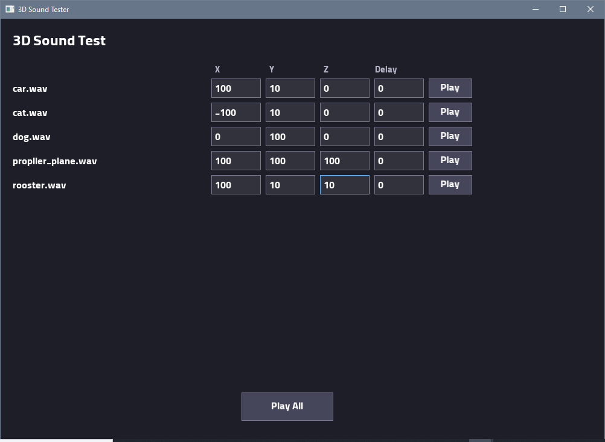

# 3D Sound Tester

A simple C++ application for testing 3D positional audio using **OpenAL Soft** and **SFML 3**.

Add WAV audio files, assign 3D coordinates to each sound, and hear how their positions affect the perceived direction and distance of the audio.

## Preview



## Prebuilt Release

If you downloaded a prebuilt release and don't want to compile the project manually, you can skip the installation and build instructions and go directly to the [Usage](#usage) section.

The release package includes several **preloaded sample sounds**, allowing you to start testing 3D positional audio immediately without adding your own WAV files.

## Features

- **3D Positional Audio:** Position sounds in 3D space using X, Y, and Z coordinates.
- **Individual Playback:** Play each sound separately to test its position.
- **Play All:** Play all loaded sounds with configurable delays.
- **WAV Support:** Load WAV files from the sounds directory.
- **HRTF:** Enable Head-Related Transfer Function for a more realistic spatial audio experience.
- **Simple GUI:** A straightforward graphical interface built with SFML.

## Requirements

To build the project from source, you need:

- A C++20-compatible compiler
- CMake 3.15 or newer
- SFML 3
- OpenAL Soft
- Git

These requirements are for compiling the project. If you downloaded a prebuilt release, you can skip this section.

## Project Structure

```text
3dsound_tester/
├── preview.png
├── LICENSE
├── assets/
│   ├── alibaba.ttf
│   └── sounds/
│       ├── sound1.wav
│       └── sound2.wav
├── libs/
│   ├── openal-soft/
│   └── SFML/
├── src/
│   ├── main.cpp
│   ├── audio.cpp
│   ├── scanner.cpp
│   ├── ui.cpp
│   └── wav_loader.cpp
├── CMakeLists.txt
└── README.md
```

The exact contents of the directories may vary depending on your build environment.

## Installation and Build

If you are using a prebuilt release, skip this section and continue to [Usage](#usage).

### 1. Clone the Repository

```bash
git clone https://github.com/codeplus819-ah/3dsound_tester.git
cd 3dsound_tester
```

### 2. Install OpenAL Soft

Clone the OpenAL Soft source code into the `libs/openal-soft` directory:

```bash
git clone https://github.com/kcat/openal-soft.git libs/openal-soft
```

The Windows CMake configuration expects the OpenAL Soft source code to be available at this location.

### 3. Install SFML 3

Download the appropriate **SFML 3** package for your operating system and compiler from the official website:

https://www.sfml-dev.org/download/

For the current Windows CMake configuration, place the SFML files in:

```text
libs/SFML/
```

Make sure the required include, library, and binary directories match the paths expected by your CMake configuration.

On Linux, CMake uses `find_package` to locate the required SFML installation and OpenAL dependencies.

### 4. Prepare the Assets

Create the following directory if it does not already exist:

```text
src/assets/sounds/
```

Place your `.wav` files inside it.

For example:

```text
src/assets/sounds/
├── engine.wav
├── footsteps.wav
└── explosion.wav
```

The Windows build configuration copies the assets into the build output directory. At runtime, the application searches for:

```text
assets/sounds/
```

Make sure the required font file, `alibaba.ttf`, is also present in the assets directory.

**Important:** The application scans for WAV files in the expected sounds directory. Keep your audio files in the correct location so they can be detected.

### 5. Configure and Build

Create a build directory:

```bash
cmake -S . -B build
```

Build the project:

```bash
cmake --build build --config Release
```

Depending on your operating system and compiler, you may need to adjust the paths in `CMakeLists.txt` before building. In particular, check `MINGW_BIN_DIR` if you are using MinGW on Windows.

After building, run the generated executable from the appropriate output directory. Ensure that the runtime assets and required SFML DLLs are available alongside the executable where necessary.

## Usage

1. Launch the application.
2. Check the list of detected sounds. Prebuilt releases include several sample sounds.
3. Assign X, Y, and Z coordinates to each sound.
4. Use the individual **Play** button to test a sound at its assigned position.
5. Use **Play All** to play all sounds together.
6. Configure the **Delay** value for each sound to control when it starts after pressing **Play All**.

### Understanding 3D Coordinates

Each sound has three coordinates:

- **X:** Horizontal position.
- **Y:** Vertical position.
- **Z:** Depth position.

The listener starts at the origin `(0, 0, 0)`. Changing a sound's coordinates changes its spatial position relative to the listener.

### Playback Delay

The delay is measured in seconds.

For example:

| Sound | Delay |
|---|---:|
| Sound 1 | 0 |
| Sound 2 | 1 |
| Sound 3 | 2.5 |

When you press **Play All**, each sound's delay is measured from the same playback trigger. Sounds can overlap if their playback durations overlap.

The individual **Play** button starts its sound immediately and does not apply the configured delay.

## Audio Compatibility

The application loads WAV files and supports mono and stereo audio with supported PCM and floating-point formats.

If a file fails to load, try converting it to a standard WAV format.

For the best positional-audio experience, use headphones.

## Window Size

The application opens in a window with a resolution of **1000 × 700 pixels**. It is not intended to run in fullscreen mode.

## Troubleshooting

### No sounds are detected

- Check that your WAV files are inside `assets/sounds/` in the runtime directory.
- On Windows, verify that the assets were copied to the build output directory.
- Ensure that the file extension is `.wav`.

### The application fails to start

- Verify that the required SFML DLLs are available on Windows.
- Check that your SFML version is compatible with the project. The code targets SFML 3.
- Make sure the required OpenAL Soft dependencies are installed or built correctly.
- Check the paths in `CMakeLists.txt`.

### A WAV file cannot be loaded

- Verify that the file is a valid WAV file.
- Try converting it to a supported PCM or floating-point WAV format.
- Make sure the audio file is mono or stereo.

## Technologies

- **C++20**
- **SFML 3** — Window management and graphical user interface
- **OpenAL Soft** — 3D positional audio
- **CMake** — Build configuration

## License

This project, **3D Sound Tester**, is licensed under the [MIT License](LICENSE).

Copyright (c) 2026 AHM.

You are free to use, copy, modify, distribute, sublicense, and sell copies of this software, provided that the copyright notice and permission notice are included in all copies or substantial portions of the Software.

See the [LICENSE](LICENSE) file for the full license text.